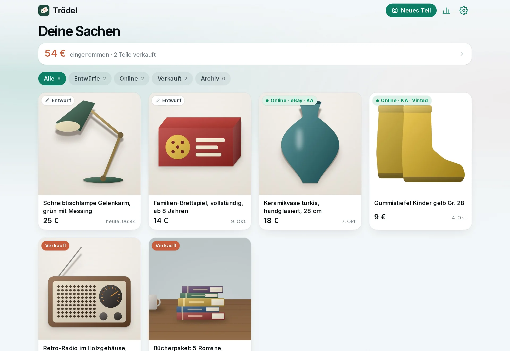
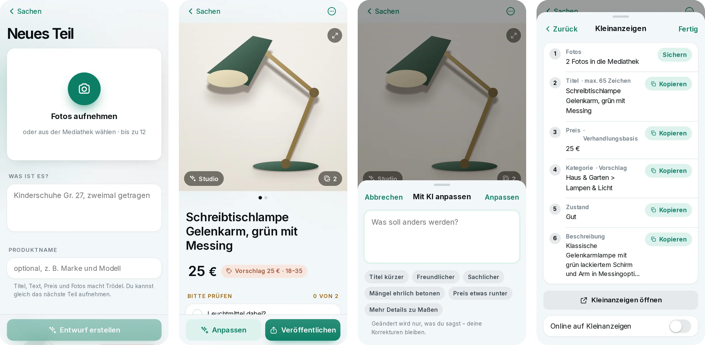
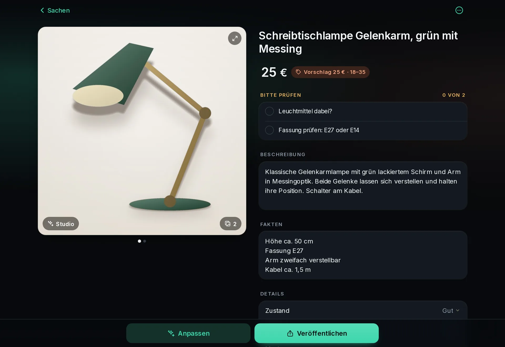

# Trödel

**Photo in, classified ad out.** Take a few pictures of the thing you want to
sell, add two words, and Trödel drafts the listing: title, description,
facts, condition, category and a price suggestion with its reasoning. It
cleans up the photos locally and gives you every field ready to copy into
Kleinanzeigen, Vinted, eBay or Facebook Marketplace.

Trödel is self-hosted, single-user software for your own computer or home
server. It never posts anything anywhere: publishing stays in your hands.



> **Status: early.** The interface and the generated listings are **German
> only** and built for the German marketplaces. Code, docs and issues are in
> English. See [docs/architecture.md](docs/architecture.md) for what a second
> language or country would take.

## What it does

- **Writes the listing** from photos and a few keywords, with the AI provider
  you choose. What it cannot see, it does not invent: it lists what you
  should check instead.
- **Revises on request**: "shorter title", "mention the missing lid", "price
  45". Only what you ask for changes; your own edits stay.
- **Edits photos on your machine**, per item:
  *Studio* (cut out, soft backdrop and shadow), *White*, *Tidy* (the original
  photo with clutter in the background retouched away) or *Original*.
  The item itself is never altered: cut-outs use original pixels only, and
  generative retouching is confined to the background. Photo metadata
  (location, device, time) is stripped on upload.
- **Prepares each platform**: lengths, wording for the condition and footer
  differ per marketplace; every field has a copy button.
- **Keeps track**: what is online where, what sold for how much, simple
  statistics.

## How it works

**1. Photograph it.** Open Trödel on your phone, take up to twelve pictures and
type what it is, in as few words as you like ("desk lamp, green, works"). A
product name helps if you know it. You can add the next item right away; the
listings are written in the background.

**2. Read the draft.** After a few seconds to a minute, depending on the
provider, the item has a title, a description, facts, condition, category,
shipping size and a price with a range and a reason. Under *Bitte prüfen*
Trödel lists what it could not tell from the photos (a size on a label, whether
the charger is included) so that you check it rather than it guessing. Every
field can be edited in place.

**3. Adjust it.** *Anpassen* takes an instruction in plain words: "shorter
title", "mention the scratch on the foot", "price 20". Only that changes, your
own edits stay, and one tap takes the change back. *Komplett neu schreiben*
starts over.

**4. Publish it yourself.** *Veröffentlichen* shows, per marketplace, the
fields in the order of that marketplace's form, already cut to its length
limits and in its wording, each with a copy button, plus the photos to save.
You paste them into the marketplace's own app or site and switch the item to
"online" there. Trödel has no marketplace login and submits nothing.



**5. Keep track.** The list shows what is a draft, what is online where and
what has sold; marking something sold with the amount feeds the statistics.



### Photo looks

Each item gets one look, changeable at any time; the originals are always kept.


| Look | What happens |
|---|---|
| *Original* | Nothing, apart from removing the metadata. |
| *Studio* | The item is cut out and set on a light backdrop with a soft shadow. |
| *Weiß* | The item is cut out and centred on white, square. |
| *Aufgeräumt* | The photo stays as taken; clutter in the background is retouched away. |

Cutting out happens on your machine with an open model that is downloaded on
first use. The pixels of the item are the ones from your photo: nothing
is redrawn, smoothed or recoloured, so the picture stays an honest one of the
thing you sell. Only *Aufgeräumt* asks the AI provider where the clutter is,
and retouches those places locally.

The screenshots show a demo instance with drawn items; `python tools/demo.py`
starts the same one without any provider or model.

## Ways to run it

| | For whom | Runs |
|---|---|---|
| [1. The download](#1-the-download-windows-and-macos) | You want to try it, or use it on your own computer | while its window is open |
| [2. Docker](#2-docker-on-a-nas-or-home-server) | The household should reach it at any time, from every phone | always, on a NAS or home server |
| [3. Python](#3-with-python) | You have Python and want neither of the above | while the command runs |

All three are the same app with the same features. Whichever you pick, you
also need an [AI provider](#ai-providers): Trödel writes nothing by itself.

### Requirements

- **The download:** Windows 10 or 11 (64-bit), or macOS 11 or later on a Mac
  with an Apple chip (M1 and later; Intel Macs are not supported). About
  700 MB of disk space. Nothing else has to be installed, no Python and no
  Docker.
- **Docker:** any machine that runs Docker with Compose, 64-bit Intel/AMD or
  ARM: a Synology or QNAP NAS, a Raspberry Pi 4 or 5, a PC.
- **Python:** version 3.12 or newer, on Linux, macOS or Windows.
- **For all of them:** a current browser, and an account or key for one of
  the [AI providers](#ai-providers), or a local model with Ollama. The photo
  editing downloads its models on first use (a few hundred MB, once, needs
  internet); writing the listings works without it.

### 1. The download (Windows and macOS)

From the [releases page](https://github.com/tk-void/troedel/releases):

- **Windows:** `troedel-<version>-windows-x64-setup.exe`. Run it; it installs
  for your user only and asks for no administrator password. Then start
  *Trödel* from the start menu.
- **macOS:** `troedel-<version>-macos-arm64.dmg`. Open it, drag *Troedel* to
  *Applications*, and open it from there.

The downloads are not signed, so the system warns once. Windows: *Weitere
Informationen* → *Trotzdem ausführen*. macOS: *System Settings → Privacy &
Security → Open Anyway*.

**What happens when you open it:** Trödel starts a small web server on your
computer, reachable only from that computer, and opens a window that says
so. The window shows the address (`http://localhost:8099`) and opens it in
your browser; the app itself is that browser page. On the very first start
the window also shows a one-time setup code: type it into the browser and
choose a password. Nothing is installed into the system, no service keeps
running: closing the window stops Trödel.

**From your phone:** tick *Im Heimnetz freigeben* in the window. It then
shows the address for other devices in the same Wi-Fi and a QR code to scan.
Only do this in a network that is yours.

**Where your data is:** in a folder `Troedel` in your home folder
(`C:\Users\<you>\Troedel`, `/Users/<you>/Troedel`), separate from the
program. The window names the folder and opens it. A newer version is
installed over the old one and finds everything there; uninstalling leaves
the folder alone. What is in it: [Your data](#your-data).

Rather not install anything on Windows? `troedel-<version>-windows-x64.zip`
is the same program as a folder: unpack it and double-click `Troedel.bat`.

### 2. Docker (on a NAS or home server)

For a Trödel that is always on and that everyone at home opens from a phone.
Save this as `compose.yaml` in a folder of its own:

```yaml
services:
  troedel:
    image: ghcr.io/tk-void/troedel:latest
    restart: unless-stopped
    ports:
      - "8099:8099"
    user: "1000:1000"        # the owner of ./data: see `id -u` and `id -g`
    volumes:
      - ./data:/data         # listings, photos and settings live here
    read_only: true
    tmpfs:
      - /tmp
```

```bash
mkdir -p data
docker compose up -d
docker compose logs troedel     # shows the one-time setup code
```

Then open `http://<address of that machine>:8099` from any device in the
network, enter the setup code, choose a password, and pick an AI provider in
the settings. On a Synology or QNAP the same file goes into *Container
Manager* or *Container Station* as a project; the setup code is in the
container's log there.

This is plain HTTP inside your network. Do not forward the port to the
internet; for access from outside, [docs/security.md](docs/security.md) has
an example with HTTPS in front.

To build the image yourself instead: clone this repository and run
`docker compose up -d --build` in it. Its `compose.yaml` is the same file
with more comments.

### 3. With Python

```bash
pipx install "troedel[cutout] @ git+https://github.com/tk-void/troedel.git"
troedel --open                   # http://127.0.0.1:8099, data in ./data
```

Leave out `[cutout]` for a much smaller install without photo editing. To
reach it from your phone, start it with `--host 0.0.0.0` and read
[docs/security.md](docs/security.md) first. `troedel window` (with the extra
`desktop`) starts the same window the downloads use.

## AI providers

Chosen in the settings; details and trade-offs in
[docs/providers.md](docs/providers.md).

| Provider | Needs | Photos go to |
|---|---|---|
| Claude (Anthropic API) | API key, pay per use | Anthropic |
| Gemini | API key; has a free tier, on which Google may use your content to improve its products | Google |
| OpenAI | API key, a vision model | OpenAI |
| Ollama | a local vision model | nowhere, they stay on your machine |
| Any OpenAI-compatible service | address, model, maybe a key | that service |
| Claude Code CLI (experimental) | the `claude` program, signed in on the same machine; not available in the Docker image | Anthropic |

Up to four photos per item are sent, downscaled, without metadata. Photo
editing never uses a provider except for *Tidy*, which asks it where the
clutter is; the retouching itself is local.

## Your data

Everything lives in one directory: `./data` (`/data` in the container), or the
folder `Troedel` in your home folder with the downloads.

```
data/
  troedel.db      listings, settings, sessions (SQLite)
  photos/         originals, edited looks, masks
  models/         downloaded on first use: cut-out and retouching models
  secrets.json    the API key, if you typed one into the settings
```

**Backup:** copy the directory, or use *Settings → Export* for a ZIP of the
database and the original photos (without the API key). `models/` can be
left out; it is downloaded again.

## Security in short

- Nothing is served without a login. The first password can only be set with
  a one-time code from the server's log.
- Passwords are stored as Argon2id hashes, session tokens only as hashes,
  login attempts are throttled.
- Trödel speaks plain HTTP. Inside a network you trust that is a reasonable
  trade-off; anywhere else put HTTPS in front of it. It is **not built to be
  exposed to the internet.**

The full picture, including an HTTPS example: [docs/security.md](docs/security.md).
To report a vulnerability: [SECURITY.md](SECURITY.md).

## The fill helper (optional, experimental)

A userscript that fills the listing form on Kleinanzeigen and Vinted in your
own browser. It is off by default, never submits, and may be against a
marketplace's terms of use. Read [docs/fill-helper.md](docs/fill-helper.md)
before switching it on.

## Configuration

Everything you would change day to day is in the app. The environment sets
what belongs to the installation; see
[docs/configuration.md](docs/configuration.md).

## Contributing

Issues and pull requests are welcome; start with
[CONTRIBUTING.md](CONTRIBUTING.md). This is a spare-time project: please do
not expect quick answers, and expect the marketplace-specific parts to break
whenever a marketplace changes.

## License

[MIT](LICENSE). Bundled and downloaded third-party parts:
[THIRD_PARTY_NOTICES.md](THIRD_PARTY_NOTICES.md).

Trödel is not affiliated with, endorsed by or connected to Kleinanzeigen,
Vinted, eBay, Meta, Anthropic, Google or OpenAI. Their names are used only to
say what the software works with.
